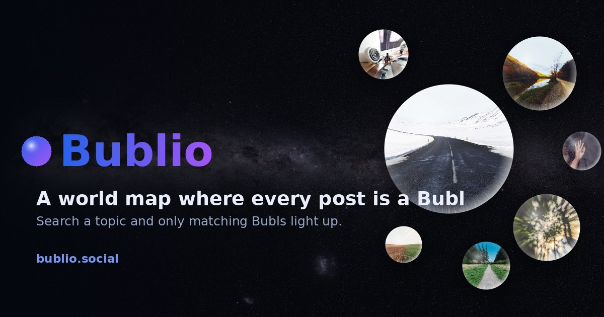

<!-- ════════════════════════════════  HEADER  ════════════════════════════════ -->


<div align="center">

<a href="https://github.com/CryptoCaleb">
  
</a>

<br/>


<a href="https://bublio.social"></a>

</div>


<!-- ════════════════════════════════  ABOUT  ════════════════════════════════ -->

<table>
<tr>
<td width="55%" valign="middle">

### 👾 &nbsp;whoami

I build across the whole stack: **web & mobile apps, desktop software, smart contracts, and the infrastructure underneath them.**

I care about pixel-perfect interfaces, clean APIs and servers that stay locked down in production.

```js
const caleb = {
  focus:     ["Full-Stack", "Mobile", "Web3", "Infra"],
  loves:     ["Pixel-perfect UI", "Clean APIs", "Hardening servers"],
  currently: "Building bubl 🫧",
  offline:   "GBA on an RG35XX Pro 🎮",
  funFact:   "Reads category theory for fun 📐",
};
```

</td>
<td width="45%" align="center" valign="middle">



</td>
</tr>
</table>


<!-- ════════════════════════════════  STACK  ════════════════════════════════ -->

<div align="center">

## 🛠️ &nbsp;Tech Stack

```
╔══════════════════════════════════════════════════════════╗
║   ⌨  languages · frameworks · data · cloud · systems  ⌨   ║
╚══════════════════════════════════════════════════════════╝
```


<br/><br/>


<br/><br/>

<sub>✦ React Native ✦ TanStack ✦ Zend ✦ CakePHP ✦ ASP.NET ✦ Shopify ✦ MariaDB ✦ Amazon RDS ✦ Gentoo ✦ macOS ✦ MailGun ✦</sub>

</div>


<!-- ════════════════════════════════  PROJECTS  ════════════════════════════════ -->

<div align="center">

## 🚀 &nbsp;Featured Projects

</div>

<table>
  <tr>
    <td width="50%" valign="top">
      <h3>🔋 &nbsp;<a href="https://github.com/CryptoCaleb/muos-battery-monitor">muos-battery-monitor</a></h3>
      <p>A muOS app for retro handhelds that tracks your battery: drain and recharge rates, charge times, estimated time left, plus graphs and analytics for checking battery health.</p>
      
      
      <br/><br/>
      <a href="https://github.com/CryptoCaleb/muos-battery-monitor"></a>
    </td>
    <td width="50%" valign="top">
      <h3>🫧 &nbsp;<a href="https://bublio.social">bubl</a></h3>
      <p>My current main project, in active development: a world map where every post is a Bubl. Search a topic and only the matching Bubls light up. Stay tuned.</p>
      
      <a href="https://bublio.social"></a>
      <br/><br/>
      <a href="https://bublio.social"></a>
    </td>
  </tr>
  <tr>
    <td width="50%" valign="top">
      <h3>🎮 &nbsp;<a href="https://github.com/CryptoCaleb/muos-collection-art">muos-collection-art</a></h3>
      <p>A muOS app for retro handhelds that turns your game collections into cover-art collages.</p>
      
      
      <br/><br/>
      <a href="https://github.com/CryptoCaleb/muos-collection-art"></a>
    </td>
    <td width="50%" valign="top">
      <h3>🌌 &nbsp;<a href="https://github.com/CryptoCaleb/aether-labs">aether-labs</a></h3>
      <p>A desktop physics lab that tests whether reality could be one continuous medium: vortex rings, acoustic black holes, emergent relativity and quantum superfluids, each checked against real theory.</p>
      
      
      <br/><br/>
      <a href="https://github.com/CryptoCaleb/aether-labs"></a>
    </td>
  </tr>
  <tr>
    <td width="50%" valign="top">
      <h3>😈 &nbsp;<a href="https://github.com/CryptoCaleb/cryptodemonz">cryptodemonz</a></h3>
      <p>Crypto Demonz, a web3 project.</p>
      
    </td>
    <td width="50%" valign="top">
      <h3>⚙️ &nbsp;<a href="https://github.com/CryptoCaleb/rpcpp-moded">rpcpp-moded</a></h3>
      <p>My modified fork of RPCPP.</p>
      
    </td>
  </tr>
</table>

<!-- ════════════════════════════════  SCREENSHOTS  ════════════════════════════════ -->

<div align="center">

## 📸 &nbsp;App Screenshots

<a href="https://github.com/CryptoCaleb/muos-battery-monitor"></a>
<br/><sub><b>Battery Monitor</b>: overview, history and health screens on a muOS handheld</sub>

<br/><br/>

<table>
  <tr>
    <td width="50%" align="center">
      <a href="https://github.com/CryptoCaleb/muos-collection-art"></a>
      <br/><sub><b>Collection Art</b>: cover collages generated for every collection</sub>
    </td>
    <td width="50%" align="center">
      <a href="https://github.com/CryptoCaleb/muos-battery-monitor"></a>
      <br/><sub><b>Battery Monitor</b>: battery health and discharge curve</sub>
    </td>
  </tr>
  <tr>
    <td width="50%" align="center">
      <a href="https://github.com/CryptoCaleb/aether-labs"></a>
      <br/><sub><b>Aether Labs</b>: quantised vortex lattice in a spinning superfluid</sub>
    </td>
    <td width="50%" align="center">
      <a href="https://github.com/CryptoCaleb/aether-labs"></a>
      <br/><sub><b>Aether Labs</b>: hypothesis scorecard, physics checked against theory</sub>
    </td>
  </tr>
</table>

</div>


<!-- ════════════════════════════════  EXTRAS  ════════════════════════════════ -->

<details>
<summary><b>🔐 &nbsp;Security toolkit</b></summary>
<br/>

```
  ┌─────────────────────────────────────────────┐
  │  [✓] live DDoS mitigation                   │
  │  [✓] SQLi · XSS/CORS · header injection     │
  │  [✓] buffer-overflow prevention             │
  │  [✓] threat isolation on servers            │
  │  [✓] ZAP · Metasploit                       │
  │  [✓] DMARC · SPF · DKIM                     │
  └─────────────────────────────────────────────┘
```

</details>

<details>
<summary><b>📐 &nbsp;Math I enjoy</b></summary>
<br/>

| ✦ Comfort zone | ✦ Deep end |
|:---:|:---:|
| Geometry · Trigonometry · Vector Algebra | Tensor Algebra · Matrix & Linear Algebra |
| Calculus · Set Theory · Graph Theory | Category Theory · Homotopy Type Theory |

</details>

<details>
<summary><b>🕹️ &nbsp;Off the clock</b></summary>
<br/>

```
     ┌──────────────────────┐
     │  ┌────────────────┐  │     now playing:
     │  │  ░░ GBA ░░ GB  │  │       ▸ GBA
     │  │  ░░ GBC ░░░░░  │  │       ▸ GB
     │  │   ▶ CONTINUE   │  │       ▸ GBC
     │  └────────────────┘  │
     │   ┼          (B)(A)  │     on: Anbernic RG35XX Pro
     │        ▬  ▬          │
     └──────────────────────┘
```

</details>


<!-- ════════════════════════════════  STATS  ════════════════════════════════ -->

<div align="center">

## 📊 &nbsp;GitHub Stats




<br/>



<br/><br/>

```
  ▄▀▄▀▄▀▄▀▄▀▄▀▄▀  thanks for stopping by  ▀▄▀▄▀▄▀▄▀▄▀▄▀▄
```

</div>

<!-- ════════════════════════════════  FOOTER  ════════════════════════════════ -->

